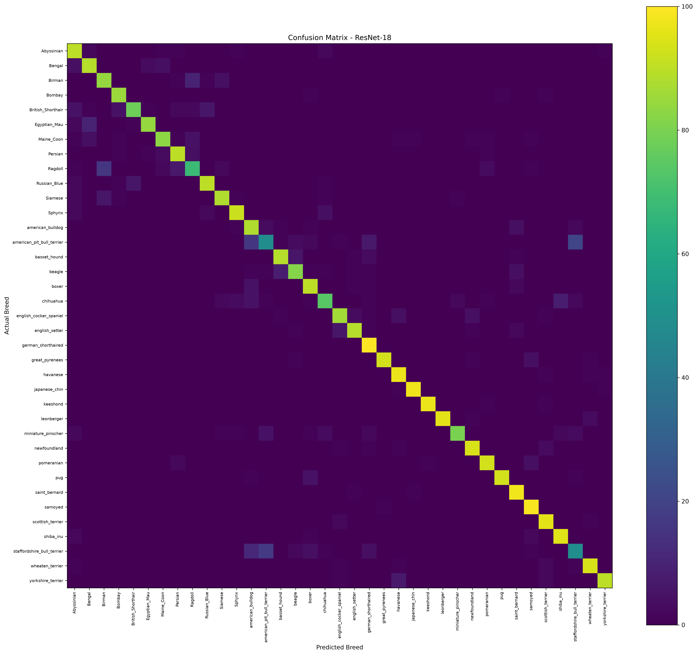
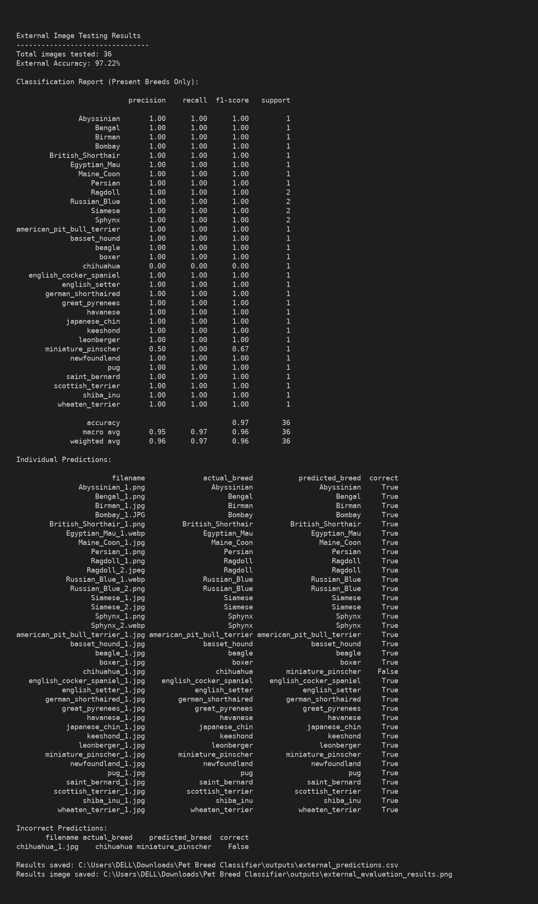

# Pet Breed Classifier

An image classifier for 37 cat and dog breeds from the Oxford-IIIT Pet dataset. The project includes the trained ResNet-18 checkpoint, test-set evaluation, external-photo evaluation, and single-image/folder inference.

## Model and training setup

- **Architecture:** ResNet-18 initialized with ImageNet-pretrained weights, with its final layer replaced by a 37-class classifier. Transfer learning provides useful visual features for a relatively small dataset, while ResNet-18 offers a practical balance of model capacity and training/inference speed.
- **Optimization:** Adam, learning rate `1e-4`, batch size `32`, for up to 10 epochs.
- **Preprocessing:** resize to `224 x 224`, ImageNet normalization; random horizontal flips are used for training only.
- **Checkpoint selection:** save the weights with the best validation accuracy.
- **Split:** the official trainval set is stratified into 2,944 training and 736 validation images; the separate 3,669-image official test set is used only by `evaluate.py`.

The existing checkpoint is `outputs/best_resnet18.pth`; its matching label order is in `outputs/class_names.json`. You do not need to train again to run inference or the evaluation scripts.

## Setup

Requires Python and the packages listed in `requirements.txt`.

```powershell
py -m venv .venv
.venv\Scripts\Activate.ps1
python -m pip install --upgrade pip
pip install -r requirements.txt
```

## Dataset

The Oxford-IIIT Pet dataset is not included in this repository. Download it locally (approximately 800 MB):

```powershell
python download_data.py
```

The scripts expect the data under `data/oxford-iiit-pet/`. The loader accepts either flat `images/` and `annotations/` folders or the nested Kaggle layout (`images/images/`, `annotations/annotations/`). To use a different location, pass `--data-dir` to `train.py` or `evaluate.py`.

The dataset is excluded from Git by `.gitignore`; do not commit the downloaded dataset.

## Run

```powershell
# Open the visual evaluation app (automatically evaluates External_pet_images)
python app.py

# Optional: retrain the model
python train.py

# Official test-set accuracy, per-breed report, and confusion matrix
python evaluate.py --num-workers 0

# Evaluate the labelled photos in External_pet_images/Cats and /Dogs
python evaluate_external.py

# Predict one image, or all supported images directly in a folder
python inference.py External_pet_images\Cats\Persian_1.png --top-k 3
python inference.py External_pet_images\Dogs --top-k 3
```

To launch it with one click in VS Code, open `app.py` and select **Run Python File**. The app displays a scrollable gallery with each image, its filename-based actual breed, the predicted breed, prediction confidence, and the overall external accuracy. Use **Choose folder...** to select another parent folder containing `Cats` and/or `Dogs` subfolders, or **Incorrect only** to review mistakes. The app also saves its predictions to `outputs/external_predictions.csv`.

`evaluate.py` saves `outputs/test_classification_report.txt` and `outputs/confusion_matrix.png`. `evaluate_external.py` saves `outputs/external_predictions.csv` and a full results image at `outputs/external_evaluation_results.png`. External filenames should use `Breed_number.ext`, such as `Persian_1.png`; supported extensions are JPG, JPEG, PNG, and WEBP.

For a reproducible public repository, include only external photos that you own or are licensed to redistribute.

## Results

### Official Oxford-IIIT Pet test set

**Accuracy: 88.03%** on the 3,669-image official test set.

The strongest and weakest breeds by F1-score were Leonberger (0.9796) and American Pit Bull Terrier (0.5568), respectively. The [full per-breed precision, recall, and F1 report](outputs/test_classification_report.txt) includes results for all 37 breeds.



### External photos

- **Images evaluated:** 36
- **Correct:** 35
- **Accuracy:** 97.22%

The [CSV file](outputs/external_predictions.csv) lists every image, its labelled breed, the predicted breed, and whether the prediction was correct. The image below contains the full evaluator output, including the classification report for the breeds in this photo set and every individual prediction.



This is a small, user-provided sample and should not be treated as a general performance estimate.

**Failure case:** `chihuahua_1.jpg` was labelled as a Chihuahua but predicted as a miniature pinscher. The model assigned 46.18% to miniature pinscher, 45.42% to Chihuahua, and 1.63% to Bombay; the incorrect top prediction was ahead of Chihuahua by only 0.76 percentage points. The photo shows a small, short-haired black-and-tan dog with upright ears. Those visual traits overlap between the two breeds, which may have led the model to confuse them; one example is not enough to establish the cause.

## What I would improve next

There are several areas where I would focus on improving the current model:

1. **Improve Data Augmentation:** The current training pipeline uses random horizontal flipping. I would experiment with additional augmentation techniques, such as random resized cropping and mild color jitter, to help the model recognize pets under different lighting conditions, backgrounds, and image compositions.

2. **Improve Difficult Breed Classification:** I would analyze the confusion matrix and per-breed precision, recall, and F1-scores to identify which breeds are frequently misclassified. For example, the American Pit Bull Terrier achieved a relatively low F1-score of 0.5568. I would investigate these classification errors and explore ways to improve performance on the more challenging breeds.

3. **Optimize Training Settings:** I would experiment with learning-rate scheduling and different training configurations, selecting the best settings based on validation performance. This could help the model learn more effectively and improve its generalization to unseen images.

4. **Expand External Evaluation:** The current external evaluation contains 36 images and achieved 97.22% accuracy. Although this is encouraging, the sample is too small to represent real-world performance. I would collect a larger and more diverse set of independently sourced images, covering all 37 breeds under different lighting conditions, backgrounds, poses, and camera qualities, to evaluate the model's generalization more reliably.

My priority would be to improve the existing ResNet-18 pipeline through better data augmentation, targeted error analysis, and more comprehensive evaluation before considering a more complex architecture.